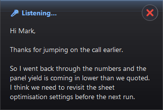
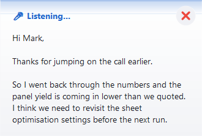
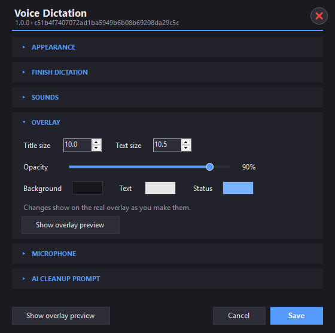
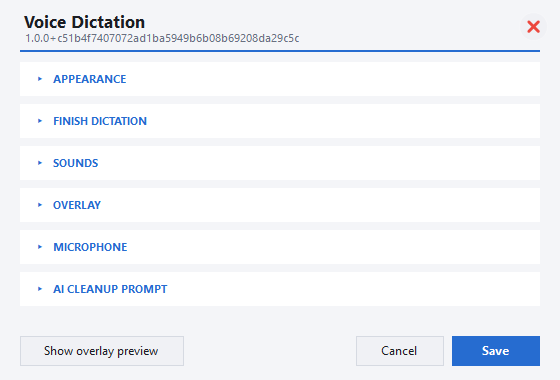
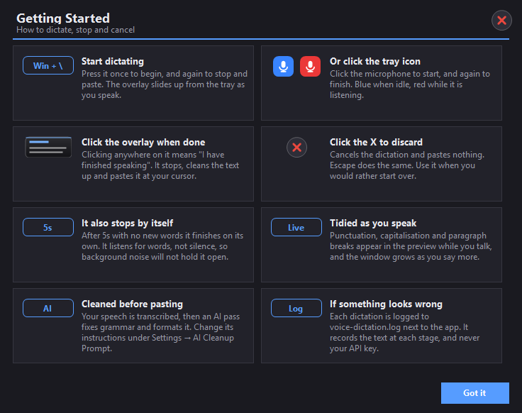

<div align="center">


# Voice Dictation

**Talk. It types.**

Press <kbd>Win</kbd>+<kbd>\\</kbd> anywhere in Windows, speak naturally, and polished text
lands at your cursor — punctuated, capitalised, paragraphed and ready to send.




</div>

---

## Why bother?

Dictation tools generally hand you a wall of lowercase text with no punctuation, and you
spend the time you saved cleaning it up. This one does the cleanup for you.

| Without it | With it |
|---|---|
| Type the message, fix the typos | Say the message |
| Add the punctuation yourself | Punctuation, capitalisation and paragraphs applied automatically |
| Reformat into something sendable | Greeting, body and sign-off already laid out |
| Switch to a dictation app, copy, switch back | Pastes straight into whatever you were already typing in |
| Wait for it to notice you stopped talking | Finishes a few seconds after your last word — background noise doesn't hold it open |

Most people speak several times faster than they type. The point of this app is to stop
giving that advantage straight back in editing.

It is genuinely **system-wide**: email, chat, a code comment, a form field, a ticket. If
you can type into it, you can talk into it.

---

## What it looks like

The overlay rises out of the system tray and shows your words **as they are being tidied**,
not as raw transcript. It grows as you speak and never steals focus from what you're typing in.

<div align="center">

&nbsp;&nbsp;

</div>

Settings are collapsible, so the window stays small and you only open what you need. The
overlay preview is the **real overlay**, so what you see while adjusting opacity and colours
is exactly what you get.

<div align="center">

&nbsp;&nbsp;

</div>

A built-in guide covers the parts that aren't obvious:

<div align="center">

</div>

---

## Features

| | |
|---|---|
| 🎙️ **Global hotkey** | <kbd>Win</kbd>+<kbd>\\</kbd> from any application, or click the tray icon |
| ✨ **AI cleanup** | Grammar, punctuation and message structure applied before pasting |
| 📝 **Live formatting** | The preview is formatted as you speak, not after |
| 🤫 **Listens for words, not silence** | A fan or background chatter won't keep the recording open |
| ⏱️ **Stops by itself** | Finishes after a configurable pause — default 5s |
| 🖱️ **Click to finish, X to discard** | No need to reach for the keyboard |
| 🎨 **Light and dark themes** | Applies to every window, including the overlay |
| 🔊 **Sound schemes** | Five presets chosen by measuring length and loudness, with per-sound overrides |
| 📐 **Overlay that grows** | Expands upward to fit what you've said; never covers the taskbar |
| 🧠 **Your own prompt** | Tell the AI to be formal, casual, British — whatever you need |

---

## How it works

```
 Win+\  ──▶  record  ──▶  Groq Whisper  ──▶  Groq LLM  ──▶  formatter  ──▶  Ctrl+V
                 │         (transcribe)      (cleanup)     (structure)
                 │
                 └── live preview every ~1s, formatted and shown in the overlay
```

The final text passes through a **deterministic formatter** after the AI, so greeting,
paragraph and sign-off structure always land, whatever the model returns. That formatter is
the part covered by the test suite.

| Endpoint | Model | Purpose |
|---|---|---|
| `/openai/v1/audio/transcriptions` | `whisper-large-v3-turbo` | Speech to text |
| `/openai/v1/chat/completions` | `openai/gpt-oss-120b` | Text cleanup |

> Groq retires models periodically. A dead model returns `404`, and because cleanup degrades
> gracefully to the raw transcript, the only symptom is an error sound and untidied text —
> check `voice-dictation.log` for `POLISH-FAILED`, then
> `GET https://api.groq.com/openai/v1/models` for what is currently available.

---

## Quick start

**Requirements** — Windows 10/11 (x64), [.NET 8 SDK](https://dotnet.microsoft.com/download/dotnet/8.0),
and a free [Groq API key](https://console.groq.com).

```powershell
git clone https://github.com/granterogers/voice-dictation.git
cd voice-dictation

dotnet publish voice-dictation.csproj -c Release -r win-x64
```

Put your key in `groq_key.txt` next to the built `VoiceDictation.exe`, then run it. (If the
file is missing on first run, the app opens a file picker and copies the key into place.)

The result is a self-contained single-file executable — no .NET install needed on the
machine that runs it. Drop a shortcut in `shell:startup` to have it there every morning.

---

## Controls

| Action | What it does |
|---|---|
| <kbd>Win</kbd>+<kbd>\\</kbd> | Start dictating; press again to finish and paste |
| **Left-click the tray icon** | Start dictating; click again to finish |
| **Click the overlay** | "I've finished speaking" — cleans up and pastes |
| **Click the ✕ on the overlay** | Cancel — nothing is pasted |
| <kbd>Esc</kbd> | Cancel — nothing is pasted |
| **Right-click the tray icon** | Getting Started, Settings, Quit |

The tray icon is **blue** when idle and **red** while listening.

Dictation also stops on its own once you've been quiet for a few seconds. It measures that by
watching whether new *words* are still arriving, not whether the microphone is quiet — so
background noise doesn't hold it open. Set the delay (or switch it off) under
**Settings → Finish Dictation**.

---

## Settings

| Section | What's in it |
|---|---|
| **Appearance** | Light / dark, applied to every window including the overlay |
| **Finish Dictation** | Seconds of no speech before it finishes; `0` disables auto-stop |
| **Sounds** | Enable, volume, five schemes with preview, or pick each sound yourself |
| **Overlay** | Separate title and text sizes, opacity, background/text/status colours |
| **Microphone** | Input device |
| **AI Cleanup Prompt** | The instructions sent to the model — make it formal, casual, British… |

Everything is stored in `settings.json` beside the executable.

---

## Troubleshooting

`voice-dictation.log`, written next to the executable, records each dictation cycle: the
sounds played and the line that triggered each one, the capture mode, and `RAW` →
`POLISHED` → `FORMATTED` text. **It never records your API key.** Start there.

| Symptom | Look for |
|---|---|
| Text isn't being cleaned up | `POLISH-FAILED` — usually a retired model |
| An unexpected sound | `SOUND` lines name the exact call site |
| It stops too early or too late | `AUTO-STOP` records measured idle time against your threshold |
| Pasted text looks truncated | `TRANSCRIBE-FAILED` / `FALLBACK` |
| Nothing pasted at all | `NO SPEECH` — the recording never crossed the speech threshold |

---

## Development

```powershell
# Build (the --source flags are required; see AGENTS.md §3)
dotnet publish voice-dictation.csproj -c Release -r win-x64 `
  --source "https://api.nuget.org/v3/index.json" `
  --source "$env:USERPROFILE\.nuget\packages"

# Tests
dotnet restore tests\VoiceDictation.Tests.csproj --source "https://api.nuget.org/v3/index.json" --source "$env:USERPROFILE\.nuget\packages"
dotnet test tests\VoiceDictation.Tests.csproj --no-restore
```

| File | What's in it |
|---|---|
| `voice-dictation-program.cs` | Tray app, overlay, audio capture, the Groq pipeline |
| `MessageFormatter.cs` | Deterministic text structuring — **under test** |
| `SpeechIdleTracker.cs` | Decides when you've stopped talking — **under test** |
| `SettingsForm.cs` | Settings window |
| `GuideForm.cs` | Getting Started guide |
| `Theme.cs` | Light/dark palette and the tray menu renderer |
| `AppIcons.cs` | Icon drawing, shared by the tray, overlay and guide |
| `tests/` | xUnit suite, 44 cases |

Stack: .NET 8 · Windows Forms · NAudio 2.2.1 · Groq API.

> **Working on this with an AI assistant?** Read [`AGENTS.md`](AGENTS.md) first — it is the
> canonical instruction set, and [`HANDOVER.md`](HANDOVER.md) carries the engineering history
> behind several non-obvious decisions.
